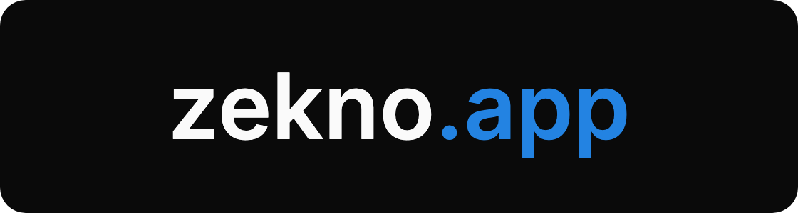
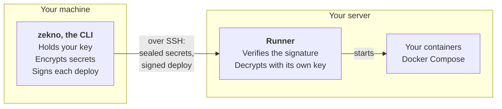
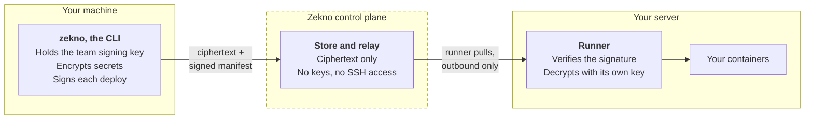
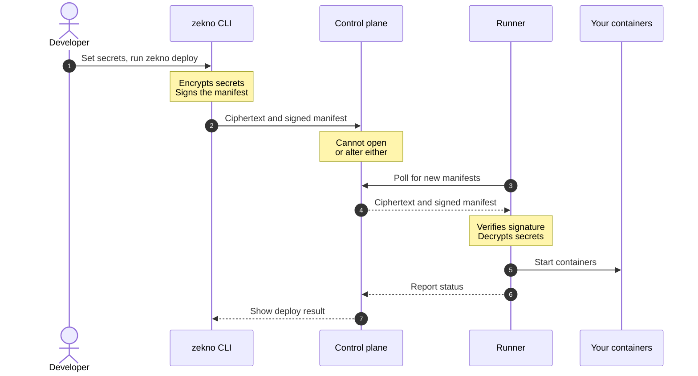

<div align="center">



# Zekno

**Deploy to your own servers through a service that can't read your secrets<br>and can't push code to your machines.**


[What works today](#what-works-today) · [Try it](#try-it) · [How it works](#how-it-works) · [Security model](#security-model) · [Repository](#repository) · [Roadmap](#roadmap)

</div>

> [!WARNING]
> **Pre-alpha and unaudited.** The command-line tool and the server runner work today, for one developer, deploying directly over SSH. The hosted service is not built yet. Do not use Zekno for anything you could not afford to lose.


<sub>zekno, the terminal app. A picture made from the real program's output.</sub>

## What works today

| Today you can | With | Docs |
| --- | --- | --- |
| Deploy a Docker Compose app to a server you own, signed on your machine | `zekno deploy` | [Deploying](https://zekno.app/docs/deploying#zekno-deploy) |
| Keep secrets encrypted for that one server | `zekno secret set`, `zekno secret import` | [Secrets](https://zekno.app/docs/secrets) |
| Describe an app by settings in place of a Compose file | `zekno settings` | [App settings](https://zekno.app/docs/settings) |
| Add a database, its passwords made on your machine | `zekno add postgres` | [Templates](https://zekno.app/docs/templates#zekno-add) |
| See what is running, read logs, roll back | `zekno`, `zekno logs`, `zekno rollback` | [The terminal app](https://zekno.app/docs/app), [Deploying](https://zekno.app/docs/deploying#zekno-logs) |

Not built yet: teammates, the hosted service, domains with HTTPS, building from source. See the [roadmap](#roadmap).

## Try it

```bash
git clone https://github.com/zekno-app/zekno && cd zekno && bun install
cd apps/cli && bun run compile   # dist/zekno: one file, for the system you are on
cd ~/my-app && zekno deploy      # with dist/zekno on your PATH; asks for your name, the server, the app
```

The [quick start](https://zekno.app/docs/quick-start) shows each step with what you will see. Zekno is not packaged yet, so it is built from this repository with [Bun](https://bun.sh) 1.4.4.

## Overview

Zekno gives a team the convenience of a managed platform (one command to deploy, teammates with roles, deploy history) on servers they own, starting with Hetzner and Docker Compose.

| Property | What it means |
| --- | --- |
| **Client-side encryption** | Secrets are encrypted on your machine. The hosted service only ever stores ciphertext. |
| **Signed deploys** | Every deploy is signed on your machine. Your servers refuse anything your team didn't sign. |
| **Auditable client code** | Everything that runs on your side is in this repository. You can read exactly what runs on your machines and in your browser. |
| **No runtime dependency** | Your servers don't need Zekno to keep your apps running. |

### Why

In October 2026, three hosting platforms had customer secrets read out of their control planes within 17 days. They shared one design flaw: the platform could decrypt every customer's secrets, so one break-in reached everyone.

Zekno is built so that a full compromise of our service yields no customer secrets and no ability to run code on customer servers.

## How it works

### Today: your machine talks to your server



No Zekno service is involved: `zekno` reaches the runner on your server directly, over SSH. Keys live at the two ends: your key in your system's keychain, the server's key on the server. The runner checks every signature before it decrypts or starts anything.

### Planned: a hosted service in the middle, holding nothing it can open

This is the design the project exists for, and it is not built yet. Teammates arrive with a hosted service that stores only ciphertext and signed deploys. The CLI stays the program that holds your key.

Keys live at the two ends. The service in the middle holds nothing it can open.



The dashed box is everything an attacker gets by breaching Zekno. If Zekno is unavailable, the CLI deploys to the runner directly, over SSH, as it does today.

#### A deploy, step by step



- **On your machine (steps 1–2).** The CLI encrypts secrets for the server's public key and signs the deploy manifest with the team key.
- **In the control plane (steps 2–4).** Zekno stores files it cannot open or alter. The runner pulls them over an outbound connection; nothing connects in to your server.
- **On your server (steps 4–5).** The runner verifies the signature against the team's public keys, then decrypts with a key that never leaves the server.

The mechanism is end-to-end encryption plus digital signatures. Zekno does not use zero-knowledge proofs; the name refers to the service having zero knowledge of your secrets.

## Security model

### Trust boundaries

| Component | Runs on | Keys it holds | Sees plaintext secrets | Can authorize a deploy |
| --- | --- | --- | :---: | :---: |
| Command-line tool (`zekno`) | A team member's machine | Team signing key | Yes | Yes |
| Control plane | Zekno's infrastructure | None | No | No |
| Runner | Your server | Server decryption key | Yes | No, it only verifies |

### What a breach of Zekno does not give an attacker

| Scenario | Outcome | Why |
| --- | --- | --- |
| Attacker copies the Zekno database | No secrets exposed | It holds only ciphertext |
| Attacker controls Zekno and pushes a malicious deploy | Deploy rejected | Servers reject manifests not signed by a team key |
| Zekno goes down | Apps keep running | Servers don't depend on it at runtime |

### What Zekno does not protect against

| Scenario | Why |
| --- | --- |
| A team member's machine is compromised | That machine holds a signing key |
| One of your servers is compromised | Secrets are plaintext in memory where the app runs |
| A Zekno release (the CLI or the runner) is tampered with | The client is the trust anchor. A server installs a runner only when it matches the checksum the CLI holds, recorded after a second build of the same source gave the same file. Runner releases are not signed |

> [!NOTE]
> The control plane still sees metadata: server addresses, app names, deploy times and team membership.

### Open-source boundary

Everything that runs on your device or in your browser is public. Everything that runs on Zekno's servers is private.

| Part | Where | Source |
| --- | --- | :---: |
| Core library (encryption, signing, manifest format) | `packages/core` | Open |
| Server runner | `apps/runner` | Open |
| Command-line tool | `apps/cli` | Open |
| Website (landing pages, docs, signed-in dashboard) | `apps/web` | Open |
| Control plane (storage and relay, teams, billing) | Hosted by Zekno | Closed |

The control plane is closed because it is the hosted service we sell. The design means you don't have to trust it: it never receives a key, and your servers refuse anything it sends that your team did not sign. Everything it receives is defined by the protocol types in `packages/core`.

### Design rules

These protect the security promise. Changes that break them need a very good reason.

1. **Private keys stay out of the interface.** The code that draws screens asks a separate part of the program to encrypt or sign, and never holds a key. This is a rule for any interface. In the CLI today the separation is in the code, not in separate processes: the screens and the code that signs run in one program. Tests in [`apps/cli/test/layers/`](apps/cli/test/layers/) check that no file that draws (`src/ui/`, and the full-screen app's screens in `src/app/screens/`) loads the keychain code or the core library, that `src/ui/` takes only types from the code that encrypts and signs (`src/ops/`), and that `src/ops/` imports nothing that draws.
2. **Keys are stored in the operating system's keychain**, never in a plain file.
3. **Nothing in this repository depends on closed code.** The CLI, the runner and the website reach the control plane only through the public protocol in `packages/core`.
4. **No secret editing in a browser.** A web page is code served fresh on every visit, so a compromised server could serve a page that steals keys. The website's dashboard is read-only for anything secret.
5. **No hosted service may hold a signing key.** Builds that deploy run on the customer's server or in their CI.
6. **Releases and updates are signed with an offline key**, and whatever installs one verifies that signature itself first. This rule is not met yet: runner releases are not signed. A server installs a runner only when its checksum equals the one the CLI holds, recorded after a second build (see the threat table above).
7. **No credentials in this repository.** Environment files are ignored by git; only `.env.example` files with placeholder values are committed.
8. **`packages/core` holds no interface or framework code**, so everything that encrypts or verifies does it with the same small library.

### Reporting a vulnerability

Please do not open public issues for security problems. Report them privately with GitHub's private vulnerability reporting: the **Report a vulnerability** button on the repository's [Security](https://github.com/zekno-app/zekno/security) tab.

## Repository

A Turborepo monorepo on Bun workspaces.

| Path | What it is | Read more |
| --- | --- | --- |
| `apps/cli` | The command-line tool, `zekno`, and its full-screen terminal app. Built and in use, for one developer deploying directly over SSH; internal reviews only, unaudited. | [Commands](https://zekno.app/docs/cli), [its README](apps/cli/README.md) |
| `apps/runner` | The program on your servers: it verifies, decrypts, starts Docker Compose, and reports running state and logs. The first release is 0.1.0; internal reviews only, unaudited. | [Server runner](https://zekno.app/docs/runner), [how a release is made](apps/runner/RELEASING.md) |
| `packages/core` | Key generation, secret encryption, signed deploys, team membership and protocol types. First version built, unaudited; the control-plane client is not written yet. | [its README](packages/core/README.md) |
| `apps/web` | The website: the landing page and the docs. The signed-in dashboard is planned. | [Docs](https://zekno.app/docs) |
| `packages/ui` | Shared React components. Scaffolded. | |
| `packages/eslint-config`, `packages/typescript-config` | Shared ESLint and TypeScript configuration. | |

- `packages/core` contains no framework code. The CLI and the runner both depend on it, so they encrypt and verify in exactly the same way.
- `apps/web` is the only website. Its dashboard shows status, deploy history, team and billing. It never handles keys or secret values; those stay on your machine.

### Tech stack

| Layer | Choice |
| --- | --- |
| Monorepo | Turborepo on Bun workspaces |
| Language | TypeScript throughout |
| Website | Next.js 16 (App Router), React 19, Tailwind CSS 4 |
| UI components | shadcn/ui on Base UI |
| Command-line tool | Bun, Ink 8 on React 19 for the terminal interface, compiled to a single executable |
| Runner | Bun, compiled to a single executable |

## Develop

### Prerequisites

- [Bun](https://bun.sh) 1.4.4, the version pinned in `package.json`
- [Node.js](https://nodejs.org) 26.13 or later in the 26.x line

### Install and run

```bash
bun install
bun run dev
```

`bun run dev` serves the website at <http://localhost:3000>. The CLI is built and tested from its own folder: see [`apps/cli/README.md`](apps/cli/README.md).

### Commands

Run these from the repository root. Turborepo runs each one across every workspace.

| Command | What it does |
| --- | --- |
| `bun run dev` | Start the apps in development mode |
| `bun run build` | Build all packages and apps |
| `bun run lint` | Lint with ESLint |
| `bun run typecheck` | Type-check with `tsc` |
| `bun run format` | Format with Prettier |
| `bun run test` | Run unit tests with Bun's test runner |

Addresses that are still to be decided (the early-access form, contact, privacy and terms pages) are empty strings at the top of `apps/web/config/site.ts`. The sources for claims about other companies are in the same file.

### How the website is organised

`apps/web` is split into feature modules, with shared code at its root.

| Folder | Holds |
| --- | --- |
| `app/` | Routes only. A page composes modules and shared layout. |
| `content/docs/` | The docs pages, as MDX files. Rendered at `/docs` by [Fumadocs](https://www.fumadocs.dev). |
| `modules/<name>/` | One feature: its `components`, `content`, `hooks`, `utils`, `types` (and `actions` when it needs them). The rest of the app imports it through `index.ts` only. |
| `components/`, `config/`, `lib/`, `providers/`, `hooks/`, `types/` | Code the app shell or more than one module needs. |

Dependencies point one way: `app` uses modules, modules use shared code, shared code never imports a module. Inside a module, files use relative imports. `modules/module-seams.test.ts` fails when a change breaks these rules.

### Adding UI components

Components come from shadcn/ui and live in `packages/ui`, so every app shares them.

```bash
bunx --bun shadcn@latest add button -c apps/web
```

```tsx
import { Button } from "@workspace/ui/components/button"
```

### Control plane access

The apps will talk to the control plane over HTTPS. A local mock for development without the hosted service is planned with it.

## Roadmap

**Built**

- [x] `packages/core`: key generation, secret encryption, manifest signing and verification, protocol types (first version, awaiting external audit)
- [x] Runner: verify, decrypt, run Docker Compose (driven directly over SSH; pulling from the control plane comes with it)
- [x] CLI: connect a server, set and remove secrets, deploy, roll back, status (direct over SSH)
- [x] CLI terminal app: Home, an app's deploys and secrets, deploys with stages, first run and adding a server from the app
- [x] Running state and live logs, read from your server over SSH (CLI and runner)
- [x] Project file `zekno.json`, signed by a member of your team and asked about once the first time it is used in a folder
- [x] Installing the runner over SSH from a release, checked against a checksum the CLI holds, and the release workflow
- [x] Publish the first runner release: 0.1.0, confirmed by a second build and proven on a real server
- [x] CLI: asks for what is missing, one command from nothing, `zekno secret import`, `zekno doctor`, `zekno --version`
- [x] CLI: app settings in zekno.app.json, zekno settings, a settings screen, the design of deploy message version 2
- [x] CLI: templates (zekno add), PostgreSQL, MySQL, MongoDB and Redis; contributed by pull request
- [x] Website: the landing page and the docs

**Next**

- [ ] Domains with HTTPS
- [ ] Building an app from source
- [ ] Creating a server
- [ ] Installing zekno with one command
- [ ] Deploys from CI with the CLI
- [ ] Railway importer

**Later**

- [ ] The hosted service, teammates and the signed-in dashboard
- [ ] Two-person approval for production deploys
- [ ] An external audit

## Contributing

The project is too early for outside contributions. Issues and design feedback are welcome, especially on the [security model](#security-model).

Templates, the ready-made services `zekno add` adds to an app, are the one exception: [CONTRIBUTING.md](CONTRIBUTING.md) says how to write one and propose it by pull request.

## License

Licensed under the MIT License. See [LICENSE](LICENSE).

The MIT License covers the code in this repository. The hosted control plane is a separate, closed-source service. The Zekno name and logo are not covered by the MIT License; please don't use them for a fork or a derived product.
