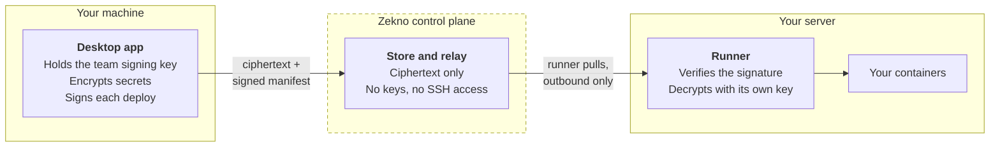
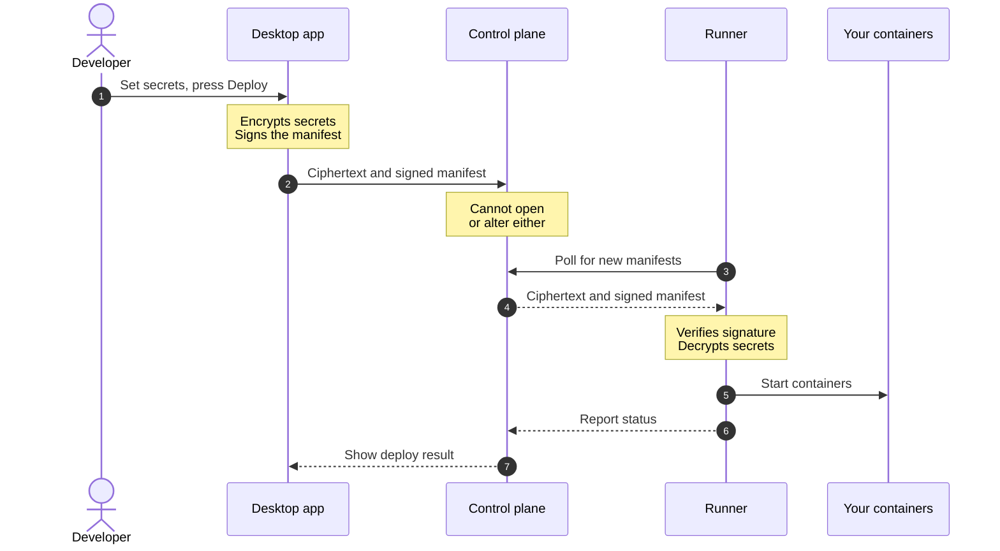

<div align="center">

# Zekno

**Deploy to your own servers through a service that can't read your secrets<br>and can't push code to your machines.**


[Overview](#overview) · [Architecture](#architecture) · [Security model](#security-model) · [Repository](#repository) · [Getting started](#getting-started) · [Roadmap](#roadmap)

</div>

> [!WARNING]
> **Pre-alpha.** This repository is being scaffolded. Nothing here is ready for production use, and the security design has not been independently audited. See [Repository](#repository) for what exists today.

## Overview

Zekno gives a team the convenience of a managed platform (a desktop app, teammates with roles, deploy history) on servers they own, starting with Hetzner and Docker Compose.

| Property | What it means |
| --- | --- |
| **Client-side encryption** | Secrets are encrypted on your machine. The hosted service only ever stores ciphertext. |
| **Signed deploys** | Every deploy is signed on your machine. Your servers refuse anything your team didn't sign. |
| **Auditable client code** | Everything that runs on your side is in this repository. You can read exactly what runs on your machines and in your browser. |
| **No runtime dependency** | Your servers don't need Zekno to keep your apps running. |

### Why

In October 2026, three hosting platforms had customer secrets read out of their control planes within 17 days. They shared one design flaw: the platform could decrypt every customer's secrets, so one break-in reached everyone.

Zekno is built so that a full compromise of our service yields no customer secrets and no ability to run code on customer servers.

## Architecture

Keys live at the two ends. The service in the middle holds nothing it can open.



The dashed box is everything an attacker gets by breaching Zekno. If Zekno is unavailable, the desktop app can deploy to the runner directly.

### A deploy, step by step



- **On your machine (steps 1–2).** The desktop app encrypts secrets for the server's public key and signs the deploy manifest with the team key.
- **In the control plane (steps 2–4).** Zekno stores files it cannot open or alter. The runner pulls them over an outbound connection; nothing connects in to your server.
- **On your server (steps 4–5).** The runner verifies the signature against the team's public keys, then decrypts with a key that never leaves the server.

The mechanism is end-to-end encryption plus digital signatures. Zekno does not use zero-knowledge proofs; the name refers to the service having zero knowledge of your secrets.

## Security model

### Trust boundaries

| Component | Runs on | Keys it holds | Sees plaintext secrets | Can authorize a deploy |
| --- | --- | --- | :---: | :---: |
| Desktop app | A team member's machine | Team signing key | Yes | Yes |
| Control plane | Zekno's infrastructure | None | No | No |
| Runner | Your server | Server decryption key | Yes | No, it only verifies |

### What a breach of Zekno does not give an attacker

| Scenario | Outcome | Why |
| --- | --- | --- |
| Attacker copies the Zekno database | No secrets exposed | It holds only ciphertext |
| Attacker controls Zekno and pushes a malicious deploy | Deploy rejected | Servers reject manifests not signed by a team key |
| Zekno goes down | Apps keep running | Servers don't depend on it at runtime |

### What Zekno does not protect against

| Scenario | Why |
| --- | --- |
| A team member's machine is compromised | That machine holds a signing key |
| One of your servers is compromised | Secrets are plaintext in memory where the app runs |
| A Zekno app or runner release is tampered with | The client is the trust anchor. Mitigated by public code and signed releases |

> [!NOTE]
> The control plane still sees metadata: server addresses, app names, deploy times and team membership.

### Open-source boundary

Everything that runs on your device or in your browser is public. Everything that runs on Zekno's servers is private.

| Part | Where | Source |
| --- | --- | :---: |
| Core library (encryption, signing, manifest format) | `packages/core` | Open |
| Server runner | `apps/runner` | Open |
| Command-line tool | `apps/cli` | Open |
| Desktop app | `apps/desktop` | Open |
| Website (landing pages, docs, signed-in dashboard) | `apps/web` | Open |
| Control plane (storage and relay, teams, billing) | Hosted by Zekno | Closed |

The control plane is closed because it is the hosted service we sell. The design means you don't have to trust it: it never receives a key, and your servers refuse anything it sends that your team did not sign. Everything it receives is defined by the protocol types in `packages/core`.

### Design rules

These protect the security promise. Changes that break them need a very good reason.

1. **Private keys stay in the desktop app's main process.** The UI asks the main process to encrypt or sign over typed RPC and never sees a key.
2. **Keys are stored in the operating system's keychain**, never in a plain file.
3. **Nothing in this repository depends on closed code.** The app, the runner and the website reach the control plane only through the public protocol in `packages/core`.
4. **No secret editing in a browser.** A web page is code served fresh on every visit, so a compromised server could serve a page that steals keys. The website's dashboard is read-only for anything secret.
5. **No hosted service may hold a signing key.** Builds that deploy run on the customer's server or in their CI.
6. **Releases and updates are signed with an offline key**, and the app verifies that signature itself before applying an update.
7. **No credentials in this repository.** Environment files are ignored by git; only `.env.example` files with placeholder values are committed.
8. **The Electrobun version is pinned**, and `packages/core` stays free of Electrobun code.

### Reporting a vulnerability

Please do not open public issues for security problems. Report them privately to the maintainers. A dedicated contact address will be listed here before the first release.

## Repository

A Turborepo monorepo on Bun workspaces. The table shows what exists today.

| Path | Purpose | Status |
| --- | --- | --- |
| `apps/web` | The website: landing pages, docs and the signed-in dashboard | Landing page built; docs started at `/docs`; dashboard planned |
| `packages/ui` | Shared React components | Scaffolded |
| `packages/eslint-config` | Shared ESLint configuration | Available |
| `packages/typescript-config` | Shared TypeScript configuration | Available |
| `packages/core` | Key generation, secret encryption, signed deploys, team membership and protocol types | First version built; unaudited. The control-plane client is not written yet |
| `apps/cli` | Command-line tool: your key, servers, secrets, deploys, running state and logs. Running `zekno` opens a full-screen terminal app built with Ink; single commands stay for scripts | Second version built: the terminal app, running state and logs read from your server, a project file (`zekno.json`), and installing the runner over SSH. No runner release is published yet, so a server still needs a runner installed by hand. One developer, deploying directly over SSH. Internal reviews only; unaudited |
| `apps/runner` | Program that runs on your servers | Second version built: verifies, decrypts, starts Docker Compose, and reports running state and logs without changing anything, over one connection per command. Internal reviews only; unaudited |
| `apps/desktop` | Desktop app (Electrobun: React UI + Bun main process) | Planned |

- `packages/core` contains no framework code. The desktop app and the runner both depend on it, so they encrypt and verify in exactly the same way.
- `apps/web` is the only website. Its dashboard shows status, deploy history, team and billing. It never handles keys or secret values; those stay in the desktop app.

### Tech stack

| Layer | Choice |
| --- | --- |
| Monorepo | Turborepo on Bun workspaces |
| Language | TypeScript throughout |
| Website | Next.js 16 (App Router), React 19, Tailwind CSS 4 |
| UI components | shadcn/ui on Base UI |
| Desktop app (planned) | Electrobun, React, Vite, Tailwind CSS |
| Command-line tool | Bun, Ink 8 on React 19 for the terminal interface, compiled to a single executable |
| Runner | Bun, compiled to a single executable |

## Getting started

### Prerequisites

- [Bun](https://bun.sh) 1.4.2, the version pinned in `package.json`
- [Node.js](https://nodejs.org) 26.13 or later in the 26.x line

### Install and run

```bash
bun install
bun run dev
```

The website is served at <http://localhost:3000>.

### Commands

Run these from the repository root. Turborepo runs each one across every workspace.

| Command | What it does |
| --- | --- |
| `bun run dev` | Start the apps in development mode |
| `bun run build` | Build all packages and apps |
| `bun run lint` | Lint with ESLint |
| `bun run typecheck` | Type-check with `tsc` |
| `bun run format` | Format with Prettier |
| `bun run test` | Run unit tests with Bun's test runner |

Addresses that are still to be decided (the early-access form, contact, privacy and terms pages) are empty strings at the top of `apps/web/config/site.ts`. The sources for claims about other companies are in the same file.

### How the website is organised

`apps/web` is split into feature modules, with shared code at its root.

| Folder | Holds |
| --- | --- |
| `app/` | Routes only. A page composes modules and shared layout. |
| `content/docs/` | The docs pages, as MDX files. Rendered at `/docs` by [Fumadocs](https://www.fumadocs.dev). |
| `modules/<name>/` | One feature: its `components`, `content`, `hooks`, `utils`, `types` (and `actions` when it needs them). The rest of the app imports it through `index.ts` only. |
| `components/`, `config/`, `lib/`, `providers/`, `hooks/`, `types/` | Code the app shell or more than one module needs. |

Dependencies point one way: `app` uses modules, modules use shared code, shared code never imports a module. Inside a module, files use relative imports. `modules/module-seams.test.ts` fails when a change breaks these rules.

### Adding UI components

Components come from shadcn/ui and live in `packages/ui`, so every app shares them.

```bash
bunx --bun shadcn@latest add button -c apps/web
```

```tsx
import { Button } from "@workspace/ui/components/button"
```

### Control plane access

The apps will talk to the control plane over HTTPS. A local mock for development without the hosted service is on the [roadmap](#roadmap).

## Roadmap

**Foundations**

- [ ] One-day spike: window, keychain access, signed build, verified auto-update (macOS and Windows)
- [x] `packages/core`: key generation, secret encryption, manifest signing and verification, protocol types (first version, awaiting external audit)

**Version 1**

- [x] Runner: verify, decrypt, run Docker Compose (driven directly over SSH; pulling from the control plane comes with it)
- [x] CLI: connect a server, set and remove secrets, deploy, roll back, status (direct over SSH)
- [x] CLI terminal app: Home, an app's deploys and secrets, deploys with stages, first run and adding a server from the app
- [x] Running state and live logs, read from your server over SSH (CLI and runner)
- [x] Project file `zekno.json`, used only once this machine accepted it
- [x] Installing the runner over SSH from a release, checked against a checksum the CLI holds, and the release workflow
- [ ] Publish the first runner release (until then a server needs a runner installed by hand)
- [ ] Desktop app: connect a server, set secrets, deploy, roll back, logs
- [ ] Website: landing pages and docs, then the signed-in dashboard
- [ ] Local mock of the control plane for development
- [ ] Railway importer

**Later**

- [ ] Deploys from CI with the CLI
- [ ] Two-person approval for production deploys

## Contributing

The project is too early for outside contributions. Issues and design feedback are welcome, especially on the [security model](#security-model).

## License

Licensed under the MIT License. See [LICENSE](LICENSE).

The MIT License covers the code in this repository. The hosted control plane is a separate, closed-source service. The Zekno name and logo are not covered by the MIT License; please don't use them for a fork or a derived product.
